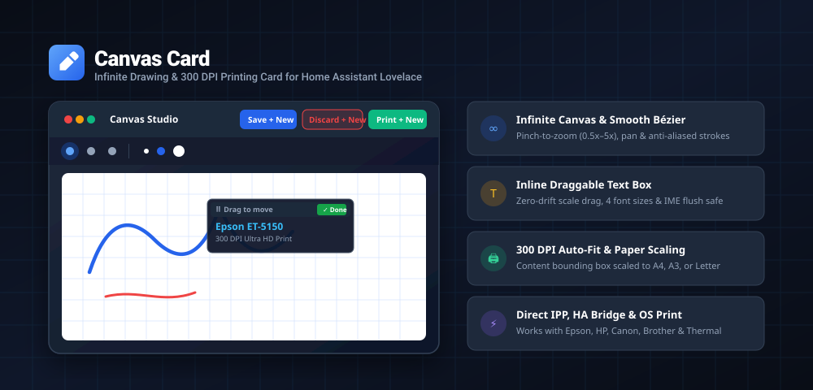

# Canvas Card (画布与打印卡片)

<p align="center">
  <a href="https://github.com/hacs/default"></a>
  <a href="https://github.com/lucayunxiao/canvas-card/releases"></a>
  <a href="LICENSE"></a>
  
</p>

<p align="center">
  <b>一款专为 Home Assistant Lovelace 设计的现代化高响应无限画布手绘与远程打印卡片</b><br/>
  支持中点二次贝塞尔曲线抗锯齿平滑笔触、双指捏合无级缩放与平移、内联零漂移悬浮文本框、300 DPI 物理纸张自适应包围盒裁切光栅化、一键保存/放弃/打印工作流，以及多模式网络打印机直连集成。
</p>

<p align="center">
  <a href="README.md"><b>English</b></a> | <a href="README_zh.md"><b>简体中文</b></a>
</p>

---

## 📸 架构拓扑与交互预览

<p align="center">
  
</p>

---

## ✨ 核心特性

- 🎨 **无边界无限画布 (Infinite Canvas)**：摆脱固定屏幕长宽限制，随心书写涂鸦。支持触控双指捏合无级缩放（`0.5x` 至 `5.0x`）与多向平移漫游，带有一键居中复位胶囊。
- ✍️ **三次/二次平滑贝塞尔笔触**：内置中点二次贝塞尔插值算法与触控防抖，彻底消除平板（iPad / Android / Apple Pencil / 手写笔）在屏幕上快速书写时的折线感与锯齿。
- 📝 **方案 A：内联可拖拽悬浮文本框 (Inline Draggable Text Box)**：
  - 点击 `[ T ]` 工具轻触画布任意位置，即可就地生成轻量悬浮输入框；
  - **带 Scale 缩放补偿的抓手拖拽条**：按住顶部拖拽条可随意拖动位置，拖动位移自动按当前画布缩放比 $\Delta X / \text{Scale}$ 换算，即使将画布放大至 300% 细排版，拖动依然 100% 跟手，绝对零漂移；
  - **4 档预设字号药丸**：小（18px）、中（26px）、大（36px）、特大（52px），预览字号均 $\ge 18\text{px}$，彻底杜绝 iOS Safari 唤起输入法时强行放大网页视口的缺陷；
  - **输入法 IME 缓冲区保护**：提交前主动调用 `blur()` 刷出移动端输入法未上屏字符，确保中文/日文拼音候选词绝不丢失；
  - **300 DPI 印刷级落印**：文字按等比例落印在无损画布图层上，并压入 Undo 撤销历史栈。
- 🖨️ **300 DPI 物理纸张动态包围盒光栅化引擎**：
  - 自动扫描并提取画布上所有有效笔画与文字图元的**紧密外接矩形 (Bounding Box)**，剔除周围多余空白；
  - 四周加入 10mm 标准安全边距，并等比例居中适配至所选物理纸张：**A4 (210 x 297 mm)**、**A3 (297 x 420 mm)**、**Letter (8.5 x 11 in)** 或 **80mm 热敏小票卷纸**；
  - 严格以 **300 DPI 印刷级超清分辨率**（A4: $2480 \times 3508\text{ 像素}$）合成渲染，实体打印出纸锐利细腻。
- ⚡ **四大核心按键高效工作流**：
  - **`Save + New` (保存并新建)**：将当前作品导出归档至本地 IndexedDB 存储库，瞬间清空画布并重置视口开启新创作；
  - **`Discard + New` (放弃并新建)**：清空画布并不保存当前草稿（自带防误触确认弹窗，可于设置中关闭）；
  - **`Print + New` (打印并新建)**：合成 300 DPI 打印任务下发给打印机，自动在历史记录中打上“已打印 (Printed)”状态标签，并重置画布；
  - **`History` (历史归档中心)**：侧边抽屉式画廊，支持缩略图浏览、载入二次编辑 (`Re-edit`)、一键重印 (`Reprint`)、导出图片 (`Export`) 与批量删除。
- 🌐 **多模式网络打印机通信栈**：
  - 模式 1：局域网直接 IPP 通信 (Port 631)
  - 模式 2：Home Assistant 官方服务/脚本桥接中继（彻底穿透 HTTPS 跨域同源限制）
  - 模式 3：专用伴生打印网关（如 `epson-web-printer` / CUPS）
  - 模式 4：全平台系统级原生打印回退（免任何网络配置，一键唤醒 AirPrint / Mopria）
- 🎛️ **全图形化配置编辑器**：基于原生 `<ha-form>` 架构，支持在仪表盘中直观配置各项属性并提供实时预览。

---

## 🔬 打印原理与预计支持范围 (Printing Principles & Scope)

### 打印底层原理解析

1. **虚拟高精坐标映射与 300 DPI 物理光栅化 (Bounding Box Rasterization)**：
   - 用户在无限画布上绘制的线条基于高精矢量坐标记录。
   - 打印调度时，算法自动扫描非透明像素的极值坐标 $[X_{\min}, Y_{\min}, X_{\max}, Y_{\max}]$，裁除外围无边界空白，并补充 10mm 打印安全边界。
   - 内存离屏 Canvas（Offscreen Canvas）根据所选纸张物理规格按标准 300 DPI 分配像素：
     $$\text{A4 离屏像素} = \frac{210\text{ mm}}{25.4\text{ mm/英寸}} \times 300\text{ DPI} \approx 2480\text{ 像素 (宽)} \times 3508\text{ 像素 (高)}$$
   - 绘制图案保持长宽比（Aspect Ratio Preserved）居中映射，无论是大幅速写还是细小签名，实体出纸均细腻平滑。

2. **通信协议栈与浏览器安全限制应对 (CORS & Mixed Content)**：
   - **IPP (RFC 8011)**：基于 HTTP 631 端口传输的 `application/ipp` 二进制协议，封装标准 `Print-Job` 指令及纸张规格参数。
   - **HTTPS 跨域 Mixed Content 突破**：当用户通过 SSL 证书或 Nabu Casa 远程访问 Home Assistant 时，现代浏览器会强制拦截页面向局域网纯 HTTP 打印机 IP 发起的直连请求。Canvas Card 构建了四级回退链路：
     1. *直连 IPP*：在本地 HTTP 访问或开放 CORS 的内网环境下直接与打印机 631 端口握手；
     2. *HA 服务桥接*：将光栅化数据通过 Home Assistant 后端中继发往打印机，规避客户端浏览器限制；
     3. *专用网关*：投递至此前部署的 `epson-web-printer` 或本地 CUPS 容器；
     4. *系统级原生打印*：一键调起浏览器底层打印对话框，无缝对接手机/平板已配对的 AirPrint 或 Mopria 打印机。

### 预计支持打印机范围矩阵

| 品牌 / 分类 | 代表支持机型 | 通信协议 | 推荐接入模式 |
| :--- | :--- | :--- | :--- |
| **Epson (爱普生)** | EcoTank 墨仓全系列 (ET-5150, ET-2800, ET-8550, L3150 等), WorkForce | IPP (Port 631), ESC/P-R, RAW 9100, AirPrint | 直连 IPP / HA 桥接 / 网关 |
| **HP (惠普)** | LaserJet 激光系列, OfficeJet Pro, DeskJet, ENVY 全系列 | IPP / IPPS, ePrint, AirPrint, PCL3GUI | 直连 IPP / HA 官方 IPP 集成 |
| **Canon (佳能)** | PIXMA 喷墨系列 (TS/G 系列), MAXIFY, imageRUNNER | IPP, UFR II, AirPrint | 直连 IPP / AirPrint |
| **Brother (兄弟)** | HL 黑白/彩色激光机, MFC 多功能一体机, DCP 系列 | IPP, B-Net, RAW 9100 | 直连 IPP / RAW 9100 |
| **热敏小票 / 标签机** | 芯烨 (Xprinter), 佳博 (Gprinter), MUNBYN, 爱普生 TM 系列 | ESC/POS (Port 9100), TSPL, IPP | 局域网 RAW 9100 / HA 桥接 |
| **系统全兼容打印** | 任何已连接至手机、平板或电脑的本地/无线打印机 | iOS AirPrint, Android Mopria, Windows 打印机, CUPS | 系统级原生打印对话框 |

---

## 📦 安装指南

### 方式 1：通过 HACS 安装（推荐）

1. 在 Home Assistant 中打开 **HACS**；
2. 点击右上角三个点 $\to$ **自定义代码库 (Custom repositories)**；
3. 输入仓库地址：`https://github.com/lucayunxiao/canvas-card`，类别选择 **Plugin**；
4. 在应用商店中搜索 `Canvas Card` 并点击 **下载 (Download)**；
5. 刷新浏览器页面即可。

[](https://my.home-assistant.io/redirect/hacs_repository/?owner=lucayunxiao&repository=canvas-card&category=plugin)

### 方式 2：手动安装

1. 下载 [`dist/canvas-card.js`](https://raw.githubusercontent.com/lucayunxiao/canvas-card/main/dist/canvas-card.js)；
2. 将 `canvas-card.js` 复制到 Home Assistant 配置目录下的 `<config>/www/` 中；
3. 进入 **设置 > 仪表盘 > 右上角三个点 > 资源**；
4. 点击 **添加资源**，URL 填写 `/local/canvas-card.js?v=1.0.0`，资源类型选择 `JavaScript Module`；
5. 刷新浏览器缓存。

---

## ⚙️ 配置说明

### 图形化配置编辑器
在仪表盘中添加卡片并选择 **编辑卡片**，即可通过可视化表单调整配置：

- **Card Title**：卡片顶栏显示的自定义标题；
- **Printer IP / Hostname**：打印机的局域网固定 IP（例如 `192.168.2.71`）；
- **Printer Port**：打印机端口（默认 IPP 为 `631`，RAW 为 `9100`）；
- **Printing Protocol / Dispatch Mode**：打印调度模式（直连 IPP、HA 服务桥接、专用网关或系统原生打印）；
- **Default Paper Format**：预设输出纸张（A4、A3、Letter、80mm 热敏纸或 1:1 内容包围盒）；
- **Canvas Background**：画布底纹样式（高对比工程网格、纯白底纸或手帐点阵）；
- **Card Height**：卡片在页面上的视口高度（350px 至 1200px 可调）。

### YAML 配置示例

```yaml
type: custom:canvas-card
title: "手绘涂鸦画板"
printer_ip: "192.168.2.71"
printer_port: 631
print_mode: "ipp"
paper_size: "a4"
canvas_bg: "grid"
confirm_discard: true
height: 540
```

---

## 🤝 官方 HACS 默认商店收录指南 (Include in Default)

按照 [HACS 官方收录要求 (Publish - Include Before You Start)](https://www.hacs.xyz/docs/publish/include/#before-you-start) 执行：

1. **本地质量核验**：
   - 确认包含完整的 `hacs.json`、`dist/canvas-card.js` 与 `.github/workflows/validate.yaml`，且 HACS Action 检查为 0 错误 0 警告；
   - 创建标准语义化 Git Tag（如 `v1.0.0`）并在 GitHub 发布附带编译包资产的 Release。
2. **Fork 官方仓库**：
   在 GitHub 上访问并 Fork [https://github.com/hacs/default](https://github.com/hacs/default) 至个人账号。
3. **在 `plugin` 文件中追加记录**：
   在 Fork 仓库的根目录下编辑 `plugin` 纯文本文件。
   > [!IMPORTANT]
   > 官方要求条目必须按**严格字母升序 (Alphabetical Order)** 排列。`canvas-card` 首字母为 `c`，必须排在 `tts-broadcast-card` (`t`) **之前**：
   ```text
   ...
   lucayunxiao/canvas-card
   lucayunxiao/tts-broadcast-card
   ...
   ```
4. **提交 Pull Request**：
   创建功能分支（如 `git checkout -b add-canvas-card`），向 `hacs/default:master` 发起 PR，按要求勾选确认模板项，等待 CI 验证通过并由社区维护者合并。

---

## 📄 开源协议

本项目采用 [MIT 许可证](LICENSE) 开源发布。
